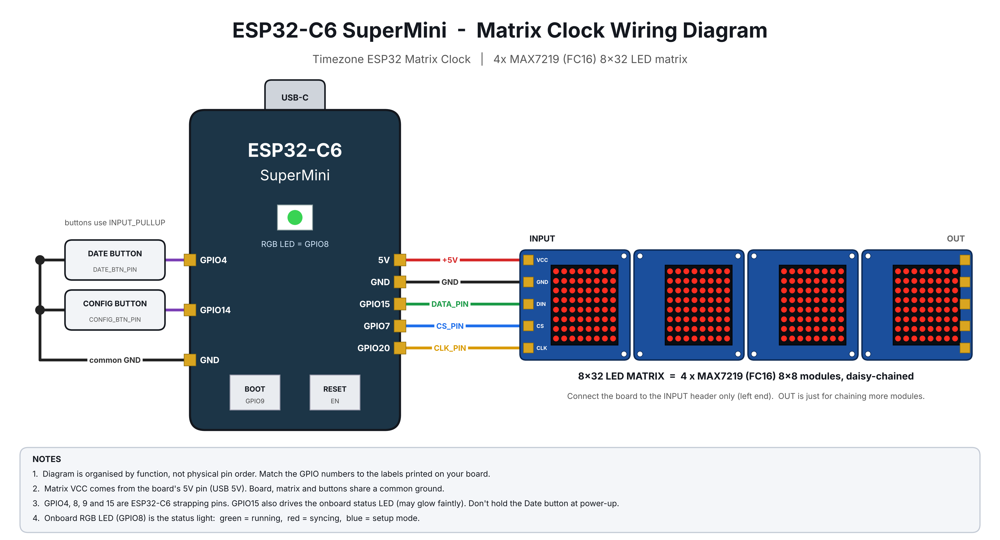

# ESP32 Timezone Matrix Clock

A maintenance-free, WiFi-synced digital clock built on an ESP32 and a 4-module MAX7219 LED matrix (8x32). It fetches the time over NTP, detects the timezone automatically (or lets you set it by hand), and is configured entirely from your phone through a built-in captive portal, so no re-flashing is needed to change WiFi.

Mini project for **24MNC 120 Design and Engineering**, Department of Electronics and Communication, Amal Jyothi College of Engineering (Autonomous), Kanjirapally. June 2026.

## Features

- **NTP time sync** every 6 hours, running as a non-blocking state machine so the display never freezes.
- **Timezone: Auto or Manual.** Auto detects the UTC offset from your public IP (ip-api.com). Manual lets you pick a UTC offset from the settings page.
- **Captive-portal setup.** Hold the Config button for 1 second to start the `ESP32-Matrix-Clock` access point, then add, delete or change WiFi networks from any phone or laptop.
- **Multiple saved WiFi networks** (WiFiMulti), stored in flash (Preferences), so settings survive power cuts.
- **Adjustable brightness** (0 to 15) from the web page.
- **Ultra-bold custom font** stored in PROGMEM for legibility at a distance.
- **Date button:** press to scroll the day and date for 10 seconds.
- **WiFi turns off after each sync** to save power and avoid EMI on the display.
- **Status LED:** green in normal operation, red while syncing, blue in setup mode.

## Hardware

| Part | Notes |
|---|---|
| ESP32-C6 SuperMini | Has an onboard RGB (NeoPixel) LED on GPIO 8 used as the status light |
| 4x MAX7219 8x8 modules, FC16 type (8x32) | Input side connected to the ESP32, powered at 5 V |
| 2x push buttons | Wired to GND, internal pull-ups used |
| USB-C 5 V supply | Must handle the LED current |

### Pin mapping

| Function | Constant | GPIO |
|---|---|---|
| Status LED (NeoPixel) | `INTERNAL_LED_PIN` | 8 |
| MAX7219 DIN | `DATA_PIN` | 15 |
| MAX7219 CLK | `CLK_PIN` | 20 |
| MAX7219 CS | `CS_PIN` | 7 |
| Date button | `DATE_BTN_PIN` | 4 |
| Config button | `CONFIG_BTN_PIN` | 14 |

Share a common ground between the ESP32, the matrix and the buttons.



The diagram is organised by function, not physical pin order, so match the GPIO numbers to the silkscreen on your board. GPIO4, 8, 9 and 15 are ESP32-C6 strapping pins, and GPIO15 also drives the onboard status LED, so avoid holding the Date button while powering up.

## Software setup

1. Install the [Arduino IDE](https://www.arduino.cc/en/software) and add ESP32 board support (Espressif's `esp32` core) via Boards Manager.
2. Install these libraries from Library Manager:
   - `MD_Parola`
   - `MD_MAX72XX`
3. Open `firmware/matrix_clock/matrix_clock.ino`.
4. Select **ESP32C6 Dev Module** (Tools > Board > esp32) and your port, then upload. If the upload fails, hold BOOT, tap RESET, then release BOOT.

`WiFi`, `WiFiMulti`, `WebServer`, `DNSServer`, `Preferences` and `HTTPClient` come with the ESP32 core.

## First use

1. Power the clock. With no saved WiFi it opens the setup portal automatically and shows `SET WIFI`.
2. Connect your phone to the WiFi network **ESP32-Matrix-Clock** (no password). The settings page opens by itself, or browse to `192.168.4.1`.
3. Add your WiFi name and password, then tap **Save & Restart**.
4. The clock connects, syncs the time and starts running.

To change settings later, hold the Config button for 1 second.

## Settings page

- **Brightness:** slider, applied immediately.
- **Timezone:** choose *Auto* or a fixed UTC offset. Manual mode does not adjust for daylight saving. Saving restarts the clock.
- **Saved networks:** list, delete with the x button.
- **Add network:** SSID and password.

## Project structure

```
esp32-matrix-clock/
├── firmware/matrix_clock/matrix_clock.ino
├── docs/
│   └── esp32-c6-supermini-pinout.png
├── LICENSE
└── README.md
```

## Team

- Levin Binoy
- Meeval Anna Manoj
- Joswin Joseph
- Joel Jacob K

## License

MIT, see [LICENSE](LICENSE).
